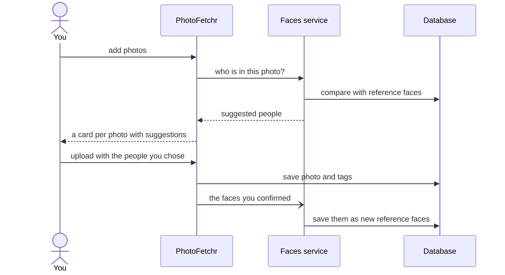

# PhotoFetchr

## Description
PhotoFetchr is an innovative solution for managing, organizing and retrieving your family photos effortlessly. The application features a PostgreSQL database that stores photo metadata and file paths, with actual photos organized in a filesystem structure. This hybrid approach combines the powerful querying capabilities of PostgreSQL with the performance benefits of filesystem storage.

The user-friendly frontend web application, powered by the Flask framework, allows users to construct complex queries visually through an intuitive interface. Users can search by people, dates, countries, and filenames to quickly find specific photos from their collection.

## Architecture

### Database Layer (PostgreSQL)
- **Metadata Storage**: Photo information, dates, countries, file paths
- **People Management**: Person identification and photo relationships
- **Advanced Queries**: Complex filtering and search capabilities

### Storage Layer (Filesystem)
- **Organized Structure**: Photos organized by year/month for performance
- **Thumbnail Cache**: Automatically generated thumbnails for fast browsing  

### Web Interface (Flask)
- **Visual Query Builder**: Intuitive interface for complex searches
- **Responsive Design**: Works on desktop and mobile devices
- **Batch Upload**: A card per photo with its own date (read from EXIF), country and people

### Faces Service (`faces/`)
- **People Suggestions**: Detects the faces in uploaded photos and suggests who they are
- **Separate Container**: Holds the face model; PhotoFetchr works without it, just without suggestions
- **Learns From Uploads**: Every face confirmed at upload becomes a reference for the next one

## Storage Structure
```text
/photos/
├── originals/
│   ├── 2023/
│   │   ├── 01/   # January photos
│   │   └── 02/   # February photos
│   └── 2024/
│       ├── 01/
│       └── 02/
└── thumbnails/
    ├── 2023/
    │   ├── 01/
    │   └── 02/
    └── 2024/
        ├── 01/
        └── 02/
```

## People Suggestions

When photos are added on the upload page, PhotoFetchr sends each one to the faces service,
which finds the faces, compares them with faces of people already known, and returns a
suggested person per face. Nothing is tagged until the suggestion is kept, changed or a
face is named on the card. After the upload, the faces whose person was confirmed are
stored as reference faces, so suggestions improve with every upload.



### The model

[InsightFace](https://github.com/deepinsight/insightface)'s `buffalo_l` pack, two
pretrained neural networks run on the CPU through onnxruntime:

1. **Preparing the photo**: turned upright from its EXIF orientation and shrunk to at
   most 1,600 px.
2. **Detection**: a face detector returns each face's box, a confidence score and five
   landmarks (both eyes, the nose tip, the corners of the mouth). Faces below 60%
   confidence are dropped.
3. **Alignment**: the five landmarks are used to rotate, scale and crop each face to a
   standard 112×112 image with the eyes in fixed positions, so a tilted head in a group
   photo compares fairly with a straight-on portrait.
4. **Recognition**: an ArcFace network turns
   the aligned face into an embedding: 512 numbers, scaled to length 1. Faces of the
   same person land close together, different people far apart, regardless of lighting,
   age, glasses or expression. Two embeddings are compared by cosine similarity, their dot product.
   1.0 is identical, and a similarity below 0.35 gets no suggestion.

### Accuracy

Measured with 5,081 reference faces of 35 people, testing each one against
references from other days:

At the threshold, **98% of faces get a suggestion and 99.3% of those suggestions are
right**. 

## Original Author
Frederik Tørnstrøm ([github.com/Frederik3152](https://github.com/Frederik3152))